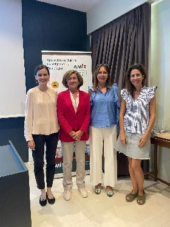
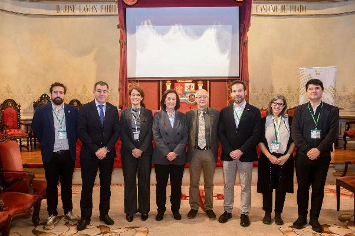
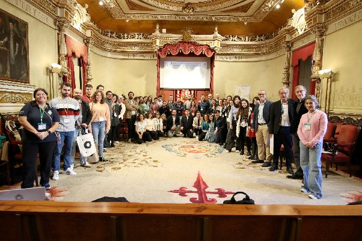
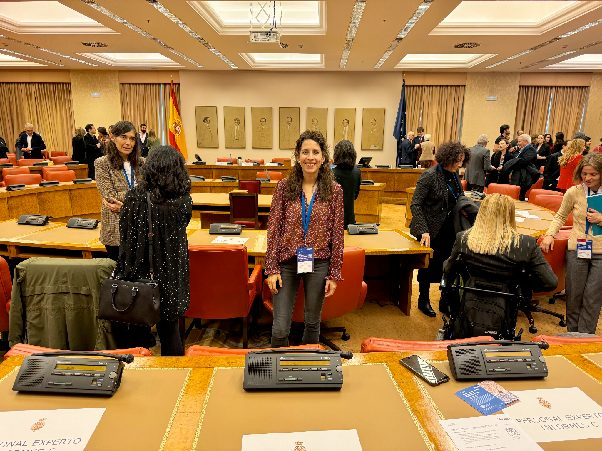

Las académicas Idoia Murga y Guiomar Niso participaron en la XXIII Asamblea General de la Asociación de Mujeres Investigadoras y Tecnólogas (AMIT) representando a la AJdE.

**La Academia Joven de España se reunió con la ministra de Ciencia, Innovación y Universidades, Diana Morant.**  
<https://www.ciencia.gob.es/Noticias/2024/Octubre/academia-joven-espana.html>   

**La Academia Joven de España celebró la IV jornada ”Los Caminos de la Investigación”, que tuvo lugar el día 25 de octubre en el Paraninfo de la Facultad de Geografía e Historia en Santiago de Compostela.**

**La Axencia Galega de Innovación y su Programa Oportunius han patrocinado este evento.**

<https://www.diariodesantiago.es/galicia/roman-rodriguez-destaca-en-la-academia-joven-de-espana-el-papel-esencial-de-la-investigacion-universitaria-para-el-futuro/>  
  

**La Académica Guiomar Niso, colabora como experta con la Oficina C del Congreso de los Diputados en la elaboración del informe “Avances en neurociencia: aplicaciones e implicaciones éticas” y participa en el acto de presentación.**  
  
**La Académica Guiomar Niso, colabora como experta con la Oficina C del Congreso de los Diputados en la elaboración del informe “Avances en neurociencia: aplicaciones e implicaciones éticas” y participa en el acto de presentación.**  
<https://oficinac.es/es/informes-c/neurociencia-aplicaciones>  
Foto: [OficinaC_GN.jpg](https://drive.google.com/file/d/11Cy3vDYWvb95DYxJCdxQ-dsOlPwCfpKY/view?usp=sharing)

